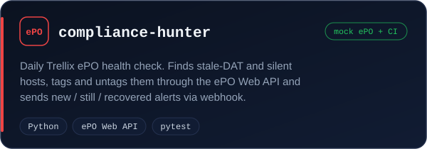
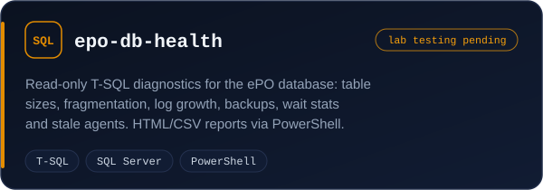
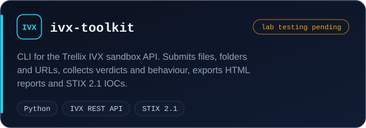
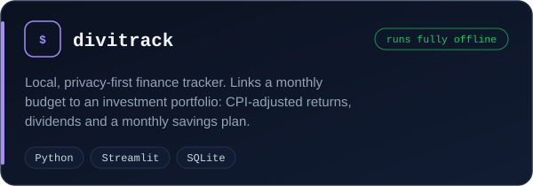
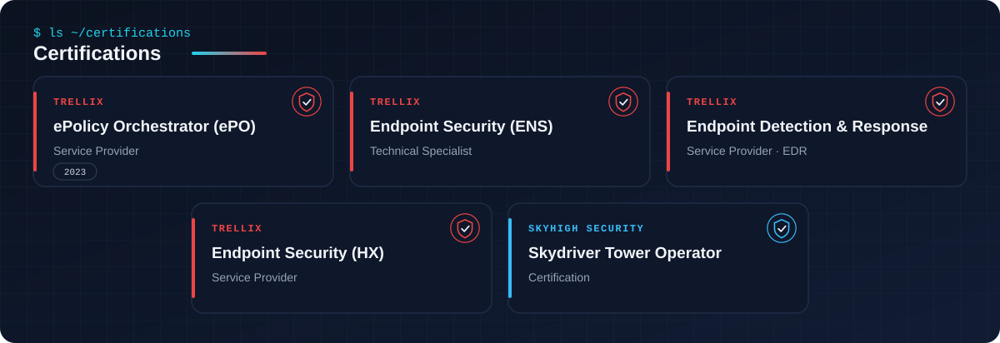
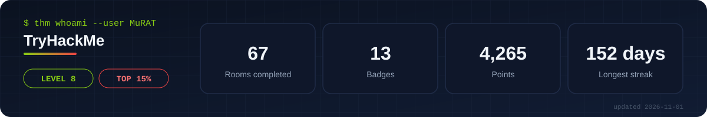
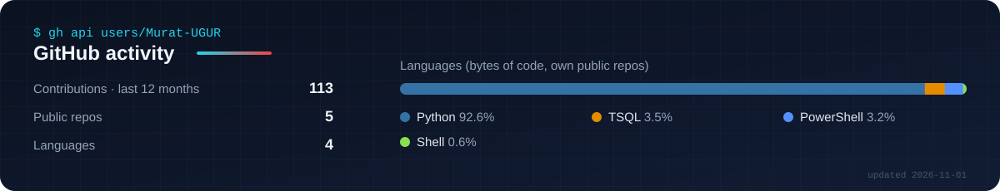

  

  
  
  
  

  

I'm a **Cyber Security Consultant** at **Komtera Teknoloji**, with a background in deploying and running the full **Trellix / McAfee / FireEye** stack in enterprise environments: ePO, ENS, HX, DXL/TIE, EX/FX/IVX, DLP and Drive Encryption. I like to **automate what I would otherwise click through**, and this GitHub is where that tooling lives.

**🔭 Currently**

- 💼 Cyber security consulting at **Komtera Teknoloji**
- 🧪 Preparing live-environment tests for **ivx-toolkit** and **epo-db-health**
- 🦀 Building the network-telemetry collector of **ShadowGuard**, an endpoint-first AI security platform, in Rust

### 🚀 Featured projects

  
  
  
  

Also contributing to <b>ShadowGuard</b> (private repo): an endpoint-first AI security platform. My part is the TCP network-telemetry collector and its ground-truth validation (Rust, Windows API).

### 🧭 Expertise

| Area | What I do |
|---|---|
| 🖥️ **Endpoint protection & EDR** | Large **ENS / HX** rollouts, behavioral-analysis tuning that cuts false positives without losing visibility |
| 🗂️ **Central management** | Designing and scaling **ePO** hierarchies; SQL Server back-end performance and storage tuning with T-SQL |
| 🧠 **Threat-intel fabric** | **DXL** architecture and **TIE** integration for real-time reputation sharing |
| ✉️ **Email, file & sandbox** | **EX**, **FX** and **IVX** deployments for deep inspection of malicious objects |
| 🔐 **Data protection** | **DLP**, File & Removable Media Protection, **Drive Encryption** lifecycle |
| 🎯 **Security validation** | Breach & attack simulation with **Picus Security** |

### 💼 Experience

| Period | Role | Company |
|---|---|---|
| **11/2026 – present** | **Cyber Security Consultant** | **Komtera Teknoloji** · Ankara |
| 06/2026 – 10/2026 | Security Technical Operations Specialist | Barikat Siber Güvenlik · Ankara |
| 09/2022 – 05/2026 | Cyber Security Specialist | Ada Mühendislik ve Yazılım Hizmetleri · Ankara |

<b>Details</b>

 

**Security Technical Operations Specialist**, Barikat Siber Güvenlik · *06/2026 – 10/2026*
- Managed enterprise security infrastructure on Trellix
- Proactive security validation with Picus Security

**Cyber Security Specialist**, Ada Mühendislik ve Yazılım Hizmetleri · *09/2022 – 05/2026*
- Led deployment, architecture and initial configuration of HX, EX, CM, FX, ENS, DLP, IVX, TIE, DXL, FRP, DE and ePO
- Designed and scaled ePO hierarchies; architected the DXL fabric; optimised TIE integration
- Drove large ENS/HX rollouts with behavioral-analysis tuning that reduced false positives
- Resolved console performance and log-storage bottlenecks with T-SQL queries and maintenance scripts
- Designed VMware / Hyper-V environments for product deployment

### 📜 Certifications

  

### 🎯 Hands-on practice

  

Hands-on labs on <a href="https://tryhackme.com/p/MuRAT">TryHackMe</a> across defensive security, SOC / SIEM (Splunk), Windows and Linux internals, Sysinternals and web security. The card is refreshed weekly from the public profile.

### 🎓 Education

- **M.Sc. Cybersecurity**, Ahmet Yesevi University *(2025)*. Thesis: *Mathematical comparison of EDR vs. AV/EPP models*, an analytical benchmark of Endpoint Detection & Response against traditional antivirus and endpoint protection platforms.
- **B.Sc. Mechanical Engineering**, Gaziantep University *(2021)*. Graduation project: an autonomous-system framework built on **ROS**.

### 🧰 Tech stack

**Security** &nbsp;

**Code** &nbsp;

**Platforms** &nbsp;

### 📈 GitHub activity

  

---

🇹🇷 Ankara'da Komtera Teknoloji'de siber güvenlik danışmanı olarak çalışıyorum. Uç nokta güvenliği, EDR/EPP ve güvenlik otomasyonu üzerine odaklanıyorum. İletişim için LinkedIn.

